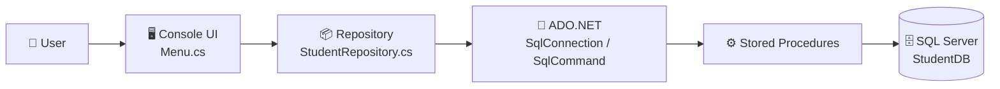

<div align="center">


<a href="https://git.io/typing-svg">
  
</a>

<br/>


</div>

---

## 📖 Table of Contents

- [About the Project](#-about-the-project)
- [Project Timeline](#️-project-timeline)
- [Features](#-features)
- [Tech Stack](#-tech-stack)
- [Architecture](#-architecture)
- [Project Structure](#-project-structure)
- [Database Design](#-database-design)
- [Getting Started](#-getting-started)
- [Usage](#-usage)
- [Validation & Error Handling](#-validation--error-handling)
- [What I Learned](#-what-i-learned)
- [Roadmap](#-roadmap)
- [Contributing](#-contributing)
- [Author](#-author)

---

## 🎯 About the Project

**Student Management System** is a console-based CRUD application built with **C#** and **SQL Server**. It lets you add, view, update, delete, and search student records, with all data stored permanently in a SQL Server database.

All database logic lives in **stored procedures**, and C# talks to them through **ADO.NET** using parameterized commands, which keeps the code clean and protects against SQL Injection.

> 💡 This project was built to practice the full path from C# fundamentals and SQL to a working, database-driven application.

---

## 🗓️ Project Timeline

|     | Milestone           | Date             |
| --- | ------------------- | ---------------- |
| 🚀  | **Started**         | 7 November 2026  |
| 🔄  | **Last Updated**    | 14 November 2026 |
| 📌  | **Current Version** | v1.0.0           |

> The **Started** and **Last update** badges at the top of this page update automatically from GitHub.

---

## ✨ Features

|     | Feature               | Description                                           |
| --- | --------------------- | ----------------------------------------------------- |
| ➕  | **Add Student**       | Save name, age, department and email                  |
| 📋  | **View All Students** | Display every record in a neat table                  |
| ✏️  | **Update Student**    | Edit a record by ID, with current values shown first  |
| 🗑️  | **Delete Student**    | Remove a record by ID with a **Y/N confirmation**     |
| 🔍  | **Search Student**    | Find students by full or partial name                 |
| ✅  | **Input Validation**  | Blocks empty, invalid, or out-of-range input          |
| 🛡️  | **Error Handling**    | Database errors never crash the app                   |
| 🔒  | **Secure Queries**    | Parameterized stored procedures prevent SQL Injection |

---

## 🧰 Tech Stack

| Layer           | Technology                           |
| --------------- | ------------------------------------ |
| Language        | C#                                   |
| Framework       | .NET (console app)                   |
| Database        | Microsoft SQL Server (Express)       |
| Data Access     | ADO.NET (`Microsoft.Data.SqlClient`) |
| Database Tool   | SQL Server Management Studio (SSMS)  |
| Version Control | Git & GitHub                         |

---

## 🏗️ Architecture

The app is split into small layers, each with one responsibility:



| Layer           | File                        | Responsibility                       |
| --------------- | --------------------------- | ------------------------------------ |
| **UI**          | `UI/Menu.cs`                | Menu, user input, validation, output |
| **Data Access** | `Data/StudentRepository.cs` | Calls stored procedures via ADO.NET  |
| **Model**       | `Models/Student.cs`         | Represents one student               |
| **Database**    | `Database/setup.sql`        | Tables and stored procedures         |

---

## 📂 Project Structure

```
student-management-system/
├── 📁 Database/
│   └── 📄 setup.sql              # Database, table & stored procedures
├── 📁 StudentManagement/
│   ├── 📁 Models/
│   │   └── 📄 Student.cs         # Student model
│   ├── 📁 Data/
│   │   └── 📄 StudentRepository.cs   # CRUD operations (ADO.NET)
│   ├── 📁 UI/
│   │   └── 📄 Menu.cs            # Console menu & validation
│   ├── 📄 Program.cs             # Entry point
│   └── 📄 StudentManagement.csproj
├── 📄 .gitignore
└── 📄 README.md
```

---

## 🗄️ Database Design

### `Students` table

| Column       | Type            | Constraints                |
| ------------ | --------------- | -------------------------- |
| `StudentId`  | `INT`           | Primary Key, Identity(1,1) |
| `Name`       | `NVARCHAR(100)` | NOT NULL                   |
| `Age`        | `INT`           |                            |
| `Department` | `NVARCHAR(50)`  |                            |
| `Email`      | `NVARCHAR(100)` | UNIQUE                     |
| `CreatedAt`  | `DATETIME`      | Default `GETDATE()`        |

### Stored procedures

| Procedure           | Purpose                          |
| ------------------- | -------------------------------- |
| `sp_AddStudent`     | Insert a new student             |
| `sp_GetAllStudents` | Return all students              |
| `sp_GetStudentById` | Return one student by ID         |
| `sp_UpdateStudent`  | Update a student by ID           |
| `sp_DeleteStudent`  | Delete a student by ID           |
| `sp_SearchStudent`  | Search students by name (`LIKE`) |

---

## 🚀 Getting Started

### Prerequisites

- [.NET SDK](https://dotnet.microsoft.com/download) (6.0 or later)
- [SQL Server Express](https://www.microsoft.com/sql-server/sql-server-downloads)
- [SQL Server Management Studio (SSMS)](https://learn.microsoft.com/sql/ssms/download-sql-server-management-studio-ssms)
- [Git](https://git-scm.com/)

### Installation

**1. Clone the repository**

```bash
git clone https://github.com/YOUR_USERNAME/student-management-system.git
cd student-management-system
```

**2. Set up the database**

Open `Database/setup.sql` in SSMS and click **Execute**. This creates the `StudentDB` database, the `Students` table, and all stored procedures.

**3. Configure the connection string**

Open `StudentManagement/Data/StudentRepository.cs` and set your own SQL Server name:

```csharp
private readonly string _connectionString =
    @"Server=localhost\SQLEXPRESS;Database=StudentDB;Trusted_Connection=True;TrustServerCertificate=True;";
```

> 🔎 Use the same **Server name** you see when connecting in SSMS (for example `localhost\SQLEXPRESS` or `(localdb)\MSSQLLocalDB`).

**4. Run the application**

```bash
cd StudentManagement
dotnet run
```

---

## 🖥️ Usage

When the app starts you will see this menu:

```
=== Student Management System ===
1. Add Student
2. View All Students
3. Update Student
4. Delete Student
5. Search Student
6. Exit
Choose an option:
```

**Example: viewing all students**

```
--- All Students ---
ID   Name                  Age   Dept        Email
----------------------------------------------------------------------
1    Karim Uddin           23    EEE         karim@example.com
2    Rahim Ahmed           21    CSE         rahim@example.com
```

---

## 🛡️ Validation & Error Handling

| Check                             | Behavior                                  |
| --------------------------------- | ----------------------------------------- |
| Empty name or department          | Asks again until a value is entered       |
| Age not a number or outside 5-100 | Asks again                                |
| Email without `@` or `.`          | Asks again                                |
| ID does not exist                 | Shows a clear "not found" message         |
| Delete                            | Asks for **Y/N** confirmation first       |
| Duplicate email                   | Caught by `try-catch`, app keeps running  |
| Database unreachable              | Friendly error message instead of a crash |

---

## 📚 What I Learned

- ✅ C# fundamentals: variables, conditions, loops, methods, classes
- ✅ Designing tables with constraints (PK, UNIQUE, NOT NULL, DEFAULT)
- ✅ Writing and calling **stored procedures** with parameters
- ✅ Connecting C# to SQL Server using **ADO.NET**
- ✅ Preventing **SQL Injection** with parameterized commands
- ✅ Structuring code into layers (UI, Data, Model)
- ✅ Exception handling with `try-catch`
- ✅ Using **Git & GitHub** for version control

---

## 🗺️ Roadmap

- [x] CRUD operations with stored procedures
- [x] Console menu with validation
- [x] Error handling and delete confirmation

---

## 🤝 Contributing

Contributions, issues, and feature requests are welcome.

1. Fork the project
2. Create your branch: `git checkout -b feature/amazing-feature`
3. Commit your changes: `git commit -m "Add amazing feature"`
4. Push the branch: `git push origin feature/amazing-feature`
5. Open a Pull Request

---

## 👤 Author

**Your Name**

[](https://github.com/dipu-ray)

---

<div align="center">

⭐ **If you found this project helpful, please give it a star!** ⭐


</div>
